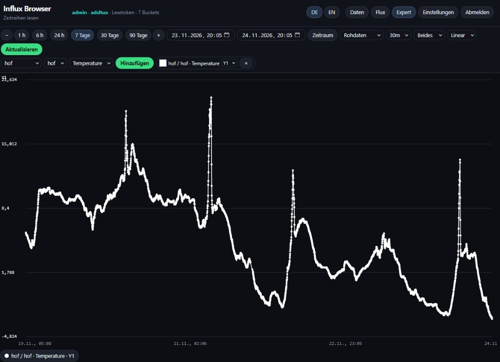

# Influx Browser

[English](README.md)

<p align="center">
  
</p>

PHP-Oberfläche zum Lesen einer **InfluxDB 2**. Kein Composer, kein CDN, keine externen Bibliotheken. Token, Passwort-Hash und optionaler TOTP-Schlüssel bleiben auf dem Server in `config.php`.

## Beispiel

Expert-Ansicht mit einer Serie aus dem Bucket `hof`:



## Funktionen

- Buckets, Measurements, Felder und Tags browsen
- Diagramm und Tabelle mit Zeitraum, Aggregation und CSV-Export
- Aggregationen: Rohdaten, Mittel, Max, Min, **Min–Max** (Band), Letzter Wert
- Flux-Reiter für reine Leseabfragen (Schreiben / HTTP / SQL werden blockiert)
- Reiter **Expert**: bildschirmfüllendes Diagramm, Serien aus allen Buckets zum Vergleich
- Mehrere Y-Achsen, Fenster-Zoom, Serienfarben, Linien / Punkte, linear / log
- Oberfläche auf Deutsch und Englisch mit Spracherkennung
- Bereiche mit der Maus skalieren (Ziehen, Mausrad, Alt+Mausrad in Listen)
- Ersteinrichtung mit Passwort (Benutzer `admin`) nur aus privaten Netzen
- Optionale TOTP-2FA (RFC 6238), QR-Code lokal erzeugt
- Ansichtswerte im Cookie `ib-ui` (beim Schreiben und Laden geprüft)
- Anmeldung im HttpOnly-Cookie `influxbrowser` (30 Tage)

## Voraussetzungen

- PHP 8.1+ mit `openssl`, `hash` und `allow_url_fopen` (HTTP über Streams; keine `curl`-Extension nötig)
- Apache (oder vergleichbar) mit PHP
- InfluxDB 2.x mit einem **Lese**-Token

## Installation

1. Projekt ins DocumentRoot legen, z. B. `/var/www/html/influxbrowser/`.
2. Beispielkonfiguration kopieren und anpassen:

```bash
cp config.example.php config.php
chmod 660 config.php
# Webserver-Benutzer muss config.php schreiben dürfen (Passwort / 2FA)
```

3. In `config.php` `url`, `org` und `token` setzen. `password_hash` für die Ersteinrichtung auf `null` lassen.
4. Die Seite von einer **privaten** Adresse öffnen und das Passwort für `admin` festlegen.

Beispiel-URL: `http://192.168.1.1/influxbrowser/`

`config.php` nicht committen. Beim direkten HTTP-Aufruf kommt 404 und ein leerer Body, solange `INFLUX_BROWSER` nicht gesetzt ist.

## Konfiguration

| Schlüssel | Bedeutung |
| --- | --- |
| `url` | Basis-URL der InfluxDB, z. B. `http://127.0.0.1:8086` |
| `org` | Organisationsname |
| `token` | Lesetoken |
| `user` | Immer `admin` |
| `password_hash` | Wird bei Einrichtung / Einstellungen gesetzt (`password_hash()`); kein Klartext |
| `totp_secret` / `totp_enabled` | Optionale 2FA; nur über die Oberfläche setzen |

## Anmeldung

### Ersteinrichtung

Nur von einer privaten Client-Adresse: `localhost`, `10.0.0.0/8`, `172.16.0.0/12`, `192.168.0.0/16`.

1. Die Seite im lokalen Netz öffnen.
2. Benutzername fest: **admin**.
3. Passwort mit mindestens 8 Zeichen wählen und wiederholen.
4. Mit **admin** und diesem Passwort anmelden. Die Einrichtung bleibt von öffentlichen Adressen aus gesperrt; die Anmeldung geht danach von überall.

Unter **Einstellungen** (nur privates Netz) lässt sich das Passwort ändern. Es kann nicht entfernt werden. Der Token wird im Formular nicht angezeigt.

### Zwei-Faktor-Anmeldung (optional)

Unter **Einstellungen** im privaten Netz:

1. **2FA einrichten** zeigt QR-Code und Schlüssel.
2. Beides in eine Authenticator-App übernehmen und den 6-stelligen Code bestätigen.
3. Danach verlangt die Anmeldung zuerst das Passwort, dann den aktuellen Code (30 s, ±1 Schritt).

Abschalten nur mit Passwort und gültigem Code. TOTP und QR-SVG stecken in `lib/Totp.php` und `lib/Qr.php`, ohne Paket aus dem Netz.

## Bedienung

### Daten

1. Bucket wählen, dann Measurement.
2. Zeitraum, Aggregation und Felder einstellen.
3. Diagramm und Tabelle aktualisieren; **CSV** speichert die Tabelle.

**Aggregation:** Rohdaten, Mittel, Maximum, Minimum, **Min–Max**, Letzter Wert.  
**Min–Max** zeichnet pro Fenster eine obere und untere Linie mit transparentem Band dazwischen (Fenstergröße gilt weiter, z. B. 15 m).

### Flux

Eigene Leseabfragen ausführen. Imports / Aufrufe zu HTTP, Sockets, SQL oder Schreibzielen werden abgelehnt.

### Expert

Nur das Diagramm. Serien aus beliebigem Bucket / Measurement / Feld hinzufügen (höchstens 12).

- **− / +** verschiebt das Zeitfenster um den gewählten Schritt (z. B. 1 h)
- **Fenster** auf dem Diagramm aufziehen zum Zoomen (Zeit und Y); Mausrad zoomt die Zeit; Doppelklick setzt zurück
- Bis zu vier Y-Achsen (**Y1**–**Y4** pro Serie; ungerade links, gerade rechts)
- Linien, Punkte oder beides; **Farbe** über das Farbfeld am Serien-Chip; Skala linear oder logarithmisch
- Dieselben Aggregationen wie unter Daten, inklusive **Min–Max**-Bänder

### Bereichsgröße

- Trennlinien ziehen
- Mausrad über dem Bereich (in scrollbaren Listen **Alt** halten)
- Doppelklick auf eine Trennlinie setzt zurück

## Cookies

| Cookie | Inhalt |
| --- | --- |
| `ib-ui` | Sprache, Layoutgrößen, Daten-/Expert-Ansicht (geprüft) |
| `influxbrowser` | Nur die Anmeldung (HttpOnly, SameSite=Lax, 30 Tage) |

Passwort, Token und TOTP-Schlüssel stehen nicht in `ib-ui`.

## Projektstruktur

```
influxbrowser/
  index.php           Oberfläche
  api.php             JSON-API
  config.example.php  Vorlage (nach config.php kopieren)
  config.php          Geheimnisse (in .gitignore)
  assets/app.js       Front-End
  assets/app.css
  assets/logo.jpg     Logo
  assets/favicon.ico  Favicon
  assets/favicon.jpg  Apple-Touch-Icon
  lib/bootstrap.php   Config, Session, Texte
  lib/Influx.php      InfluxDB-Client
  lib/Totp.php        TOTP nach RFC 6238
  lib/Qr.php          Lokaler QR als SVG
  docs/expert.jpg     Beispiel-Screenshot (Expert)
  README.md           Englisch
  README.de.md        Deutsch
```

## Sicherheit

- Am besten einen reinen Lese-Token verwenden.
- `config.php` mit Modus `660`, schreibbar nur für App-Benutzer / Webserver-Gruppe.
- CSRF: API braucht den Header `X-Influx-Browser: 1` und einen passenden Referer unter dem App-Pfad.
- Solange kein Passwort existiert, bleibt die Oberfläche für nicht-private Clients geschlossen.

## Lizenz

[GNU General Public License v3.0](LICENSE)
