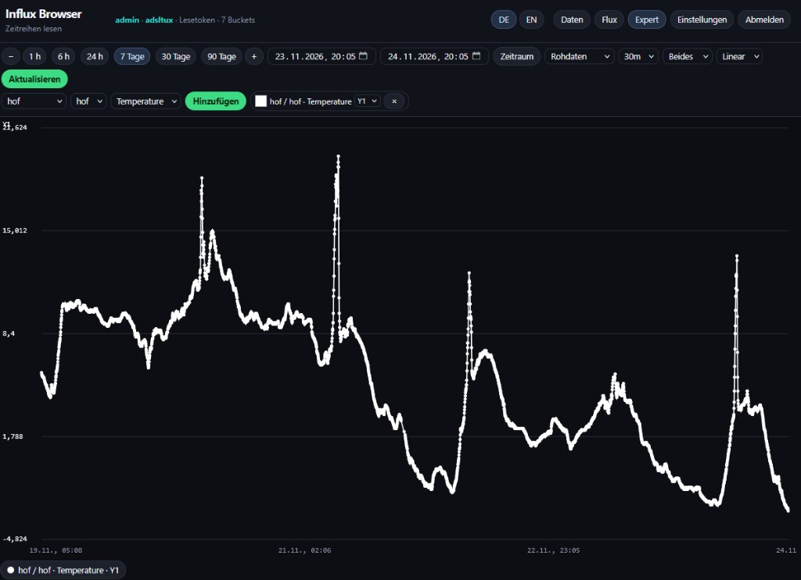

# Influx Browser

[Deutsch](README.de.md)

<p align="center">
  
</p>

PHP front end for reading an **InfluxDB 2** instance. No Composer packages, no CDN, no external libraries. The Influx token, the password hash, and the optional TOTP secret stay on the server in `config.php`.

## Example

Expert view with a series from the `hof` bucket:



## Features

- Browse buckets, measurements, fields, and tags
- Chart and table with time range, aggregation, and CSV export
- Aggregations: raw, mean, max, min, **Min–Max** (band), last
- Flux tab for read-only queries (write / HTTP / SQL calls are blocked)
- **Expert** tab: full-screen chart, series from any buckets for comparison
- Multiple Y axes, box zoom, series colors, lines / points, linear / log scale
- German / English UI with browser language detection
- Resizable panes (drag, mouse wheel, Alt+wheel in lists)
- First-run password setup (user `admin`) from private networks only
- Optional TOTP 2FA (RFC 6238), QR code generated locally
- View settings in cookie `ib-ui` (validated on write and read)
- Auth session in HttpOnly cookie `influxbrowser` (30 days)

## Requirements

- PHP 8.1+ with `openssl`, `hash`, and `allow_url_fopen` (HTTP via streams; no `curl` extension required)
- Apache (or similar) with PHP
- InfluxDB 2.x with a **read** token

## Install

1. Copy this project into your web root, for example `/var/www/html/influxbrowser/`.
2. Copy the example config and edit it:

```bash
cp config.example.php config.php
chmod 660 config.php
# ensure the web server user can write config.php (password / 2FA)
```

3. Set `url`, `org`, and `token` in `config.php`. Leave `password_hash` as `null` for first-run setup.
4. Open the app from a **private** address and set the `admin` password.

Example URL: `http://192.168.1.1/influxbrowser/`

`config.php` must not be committed. Requesting it over HTTP returns 404 and an empty body when `INFLUX_BROWSER` is not defined.

## Configuration

| Key | Meaning |
| --- | --- |
| `url` | InfluxDB base URL, e.g. `http://127.0.0.1:8086` |
| `org` | Organization name |
| `token` | Read token |
| `user` | Always `admin` |
| `password_hash` | Set by setup / settings (`password_hash()`); not a clear-text password |
| `totp_secret` / `totp_enabled` | Optional 2FA; set only through the UI |

## Authentication

### First-time setup

Only from a private client address: `localhost`, `10.0.0.0/8`, `172.16.0.0/12`, `192.168.0.0/16`.

1. Open the app on the local network.
2. User name is fixed: **admin**.
3. Choose a password (at least 8 characters) and confirm it.
4. Sign in with **admin** and that password. Setup stays blocked from public addresses; sign-in works from anywhere after that.

In **Settings** (private network only) you can change the password. It cannot be removed. The token is not shown in the form.

### Two-factor sign-in (optional)

Under **Settings** on the private network:

1. **Set up 2FA** shows a QR code and the secret.
2. Add them to an authenticator app and confirm the 6-digit code.
3. Sign-in then asks for the password, then the current code (30 s, ±1 step).

Turn-off needs the password and a valid code. TOTP and the QR SVG are implemented in `lib/Totp.php` and `lib/Qr.php` with no packages from the network.

## Usage

### Data

1. Choose a bucket, then a measurement.
2. Set range, aggregation, and fields.
3. Chart and table update; **CSV** exports the table.

**Aggregation** options: raw, mean, maximum, minimum, **Min–Max**, last.  
**Min–Max** draws an upper and lower line per window with a transparent band between them (window size still applies, e.g. 15 m).

### Flux

Run your own read queries. Imports / calls that talk to HTTP, sockets, SQL, or write sinks are rejected.

### Expert

Full-screen chart only. Add series from any bucket / measurement / field (up to 12).

- **− / +** shift the time window by the selected step (e.g. 1 h)
- Drag a **box** on the chart to zoom (time and Y); mouse wheel zooms time; double-click resets
- Up to four Y axes (**Y1**–**Y4** per series; odd left, even right)
- Lines, points, or both; **color** via the swatch on each series chip; linear or logarithmic scale
- Same aggregations as Data, including **Min–Max** bands

### Pane size

- Drag dividers
- Mouse wheel on a section (hold **Alt** inside scrolling lists)
- Double-click a divider to reset

## Cookies

| Cookie | Content |
| --- | --- |
| `ib-ui` | Language, layout sizes, browse/expert view choices (validated) |
| `influxbrowser` | Auth session only (HttpOnly, SameSite=Lax, 30 days) |

Password, token, and TOTP secret are never stored in `ib-ui`.

## Project layout

```
influxbrowser/
  index.php           UI shell
  api.php             JSON API
  config.example.php  Template (copy to config.php)
  config.php          Secrets (gitignored)
  assets/app.js       Front end
  assets/app.css
  assets/logo.jpg     Logo
  assets/favicon.ico  Favicon
  assets/favicon.jpg  Apple touch icon
  lib/bootstrap.php   Config, session, i18n helpers
  lib/Influx.php      InfluxDB client
  lib/Totp.php        RFC 6238 TOTP
  lib/Qr.php          Local QR SVG
  docs/expert.jpg     Example screenshot (Expert)
  README.md           English
  README.de.md        German
```

## Security notes

- Prefer a read-only Influx token.
- Keep `config.php` mode `660` and writable only by the app user / web server group.
- CSRF: API calls need header `X-Influx-Browser: 1` and a matching Referer under the app path.
- Until a password exists, the whole UI is closed to non-private clients.

## License

[GNU General Public License v3.0](LICENSE)
